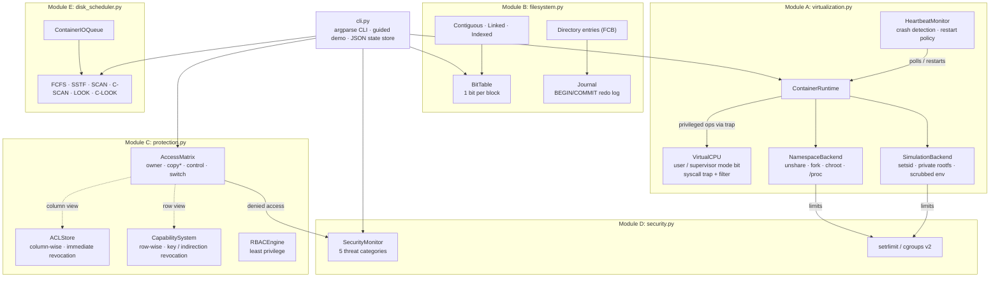

# os-container-sandbox

[](https://github.com/govindmishra2006/os-container-sandbox/actions/workflows/ci.yml)

**Lightweight OS-Level Virtualization & Protection Engine** — a Python library and CLI that builds the core pieces of a container runtime from first principles: kernel namespaces, a dual-mode CPU model, a journaling block file system, an access-matrix protection engine, DoS-resistant resource limits, and a disk I/O scheduler.

It runs **real Linux namespaces** (`unshare` + `fork` + `chroot`) when started as root on Linux, and falls back to a **portable user-space simulation** everywhere else (macOS, unprivileged Linux). It has no runtime dependencies beyond the Python standard library.

```
$ sudo sandbox run --hostname guest-ns -- sh -c 'echo $(hostname) pid=$$; ls /proc | grep -E "^[0-9]+$"'
inside: hostname=guest-ns pid=1
procs: 1 3 4 5 6            # the guest sees only its own process tree
```

---

## Table of contents
1. [Architecture](#architecture)
2. [Setup](#setup)
3. [Usage](#usage)
4. [Testing](#testing)
5. [Operating-systems theory (interview guide)](#operating-systems-theory-interview-guide)
6. [Design decisions & limitations](#design-decisions--limitations)

---

## Architecture



### How one container starts (namespace backend)

```
 host process (user mode)
   │  runtime.run(spec)
   ▼
 VirtualCPU.syscall("create_container")  ── mode bit 1 → 0 (supervisor) ──┐
   │  validate spec, register container                                    │
   ◄──────────────────────────────────── mode bit 0 → 1 (user) ────────────┘
   │
   ├─ fork() ─────────────► child
   │                          unshare(CLONE_NEWUTS|NEWNS|NEWPID|NEWIPC)
   │                          fork() ─────────────► grandchild  ← PID 1 in new PID ns
   │                          waitpid()               sethostname(spec.hostname)
   │                                                  mount("/", MS_REC|MS_PRIVATE)
   │                                                  chroot(rootfs); chdir("/")
   │                                                  mount proc on /proc
   │                                                  setrlimit(...)
   │                                                  execvpe(command)
   ▼
 HeartbeatMonitor polls waitpid(WNOHANG) → crash? → restart (policy, budget)
```

### Repository layout

```
os-container-sandbox/
├── pyproject.toml
├── Dockerfile              # Linux image for real namespace mode
├── .github/workflows/ci.yml
├── LICENSE
├── README.md
├── src/container_sandbox/
│   ├── virtualization.py   # Module A: namespaces, dual mode, HA monitor
│   ├── filesystem.py       # Module B: bit table, allocation, journaling
│   ├── protection.py       # Module C: access matrix, ACL, capabilities, RBAC
│   ├── security.py         # Module D: rlimits/cgroups, threat detection
│   ├── disk_scheduler.py   # Module E: six disk-scheduling algorithms
│   ├── cli.py              # argparse CLI + guided demo
│   └── __main__.py         # python -m container_sandbox
└── tests/                  # 106 pytest tests, one file per module + CLI
```

---

## Setup

Requires Python ≥ 3.9 (≥ 3.12 for real namespaces, because `os.unshare` was added in 3.12).

```bash
cd os-container-sandbox
python3 -m venv .venv && source .venv/bin/activate
pip install -e ".[dev]"
sandbox info
```

Without installing, you can run it from the source tree:

```bash
PYTHONPATH=src python3 -m container_sandbox demo
```

To try real namespaces from macOS or Windows, use the bundled Dockerfile (namespaces need `--privileged`):

```bash
docker build -t os-sandbox .
docker run --rm -it --privileged os-sandbox sandbox shell --hostname guest
docker run --rm --privileged os-sandbox pytest -rs        # includes the real-namespace test
```

---

## Usage

`fs` and `matrix`/`acl`/`cap` state is saved in `./.sandbox_state/` (override it with `--state-dir` or `$SANDBOX_STATE_DIR`), so a series of commands behaves like one running kernel.

### Guided tour (safe, no root)
```bash
sandbox demo
```

### Containers
```bash
sandbox info                                   # namespace or simulation?
sudo sandbox shell --hostname box1 --memory 256 --nproc 64      # isolated shell
sandbox run --simulate --cpu 2 -- python3 -c "while True: pass" # killed by SIGXCPU
sandbox run --ha --max-restarts 3 -- sh -c 'sleep 1; exit 1'    # auto-restarted
sandbox ha-demo                                # crash/restart walkthrough
sandbox modes                                  # user vs supervisor trap demo
```

### Virtual file system
```bash
sandbox fs init --blocks 64 --block-size 64
sandbox fs create report --data "quarterly numbers" --method indexed --owner alice --protection rw-r-----
sandbox fs create log    --data "$(printf 'x%.0s' {1..200})" --method linked
sandbox fs create boot   --size 256 --method contiguous
sandbox fs ls                      # name, type, address, lengths, dates, owner, protection
sandbox fs bitmap                  # raw bit table + ownership map (J=journal, I=index block)
sandbox fs access log 3            # direct-access cost: contiguous 1, indexed 2, linked k+1
sandbox fs journal                 # write-ahead metadata log
sandbox fs crash                   # power loss halfway through a create
sandbox fs recover                 # redo committed, discard uncommitted
```

Example `fs bitmap` ownership view:
```
    0: JJJJDD0BBBBIGGGGG0000000000000000000000000000000
  blocks=48 block_size=16B used=16 free=32 journal=4 ext_frag=3%
```

### Protection
```bash
sandbox matrix init                          # textbook policy: D1-D4 × F1-F3, printer
sandbox matrix show
sandbox matrix check D1 F1 read              # exit 0 = allowed, 2 = denied
sandbox matrix switch D1 D2                  # needs switch ∈ Access(D1, D2)
sandbox matrix copy D2 F2 read D1 --mode limited   # needs read* ∈ Access(D2, F2)
sandbox matrix owner-grant D1 F1 D3 write    # D1 owns F1
sandbox matrix control D2 D4 F1 write        # D2 has control over D4: remove write
sandbox acl show F3
sandbox acl revoke F3 D4 write               # immediate
sandbox cap issue D1 F1 read --scheme key
sandbox cap issue D3 F2 read --scheme indirection
sandbox cap revoke-key F1                    # re-key: all F1 key-caps die
sandbox cap revoke-entry 1                   # kill one indirection entry
sandbox cap list
sandbox rbac                                 # least-privilege role activation demo
```

### Security
```bash
sandbox security            # simulated violations in all five categories
sandbox security --limits   # live: CPU spinner vs RLIMIT_CPU, memory hog vs RLIMIT_AS
```

### Disk scheduling benchmark
```bash
sandbox disk                                   # textbook queue, head 53
sandbox disk --direction down --trace SCAN
sandbox disk --random 30 --size 500 --head 250 --trace ALL
sandbox disk --containers 4                    # containers enqueue block I/O → cylinders
```
```
Algorithm Movement  Avg seek  Chart
FCFS          640      80.0  ########################################
SSTF          236      29.5  ###############  <- best
SCAN          331      41.4  #####################
C-SCAN        382      47.8  ########################
LOOK          299      37.4  ###################
C-LOOK        322      40.2  ####################
```

---

## Testing

```bash
pytest            # or: python3 -m pytest -v
```

| File | What it proves |
|---|---|
| `test_virtualization.py` | dual-mode traps and the syscall filter, fallback to simulation without root, guest hostname/rootfs/session isolation, scrubbed environment, limits inside the guest, HA restart and give-up logic, the background monitor thread, **real PID/UTS/mount namespaces** (Linux+root only) |
| `test_filesystem.py` | bit packing, first-fit contiguous search, fragmentation metric, all three allocation methods, direct-access cost, index capacity, directory attributes, grow/shrink, journaling, crash recovery (committed replayed, torn discarded, idempotent, checkpoint tail) |
| `test_protection.py` | rights enforcement, domain switching, copy/limited/transfer, owner and control rights, ACL immediate revocation and defaults, key vs indirection revocation, forged-capability rejection, RBAC activation |
| `test_security.py` | token-bucket DoS throttling, classification of all five threat categories, PBKDF2 masquerade detection, live `RLIMIT_CPU` / `RLIMIT_FSIZE` enforcement, `RLIMIT_AS` (Linux) |
| `test_disk_scheduler.py` | textbook totals (FCFS 640, SSTF 236, SCAN↓ 236, C-SCAN 382, LOOK, C-LOOK), edge cases, container queue to cylinder mapping |
| `test_cli.py` | end-to-end CLI flows with persisted state, plus the full demo |

CI (GitHub Actions) runs the suite on Ubuntu and macOS for Python 3.9, 3.11, 3.12 and 3.13. A separate job runs it **as root on Linux**, so the real-namespace test executes, and then runs a namespace smoke test.

Current results: **104 passed / 2 skipped on macOS** (Python 3.9, 3.13 and 3.14) (the skipped tests are Linux-only), and **105 passed / 1 skipped on Linux as root** in `python:3.12-slim --privileged` (the skipped test checks the behaviour when root is missing).

---

## Operating-systems theory (interview guide)

### 1. OS-level virtualization vs. hypervisors
| | Hypervisor (VMware, KVM) | OS-level (containers) |
|---|---|---|
| Guest kernel | one per VM | **shared host kernel** |
| Isolation boundary | virtual hardware | kernel namespaces + cgroups |
| Overhead | device emulation, a whole guest OS | close to zero: guests are ordinary processes |
| Start-up | seconds | milliseconds |

The host kernel gives each guest a *restricted view* of global resources, so the guest has the **illusion of its own machine**: its own PID numbering (its init is PID 1), hostname, mount table and IPC. `chroot` gives it its own root directory, and resource limits give it what looks like its own CPU and memory budget.

**Namespaces used (`virtualization.py`):**
- `CLONE_NEWPID`: new PID numbering. It applies to the *children* of the caller, which is why the runtime forks twice. The second child becomes PID 1.
- `CLONE_NEWUTS`: private hostname (`sethostname` does not affect the host).
- `CLONE_NEWNS`: private mount table. The runtime remounts `/` with `MS_PRIVATE` so that mounting `/proc` inside the guest does not propagate back to the host.
- `CLONE_NEWIPC`: private System V IPC.

**Interview line:** *"A container isn't a VM. It's a process the kernel lies to about PIDs, hostname and mounts, and that's why it starts in milliseconds."*

### 2. Dual-mode operation (user vs. supervisor)
Hardware provides a **mode bit** (1 = user, 0 = kernel/supervisor). Privileged instructions (I/O, timer control, MMU updates) only run when the bit is 0. If user code tries one, the CPU raises a **trap**, the OS takes over, and the offending process is usually killed. The only legitimate way into kernel mode is a **system call**: a trap instruction switches to supervisor mode, jumps to a kernel handler that validates its arguments, and returns to user mode.

`VirtualCPU` models this. `execute("mount")` in user mode raises `PrivilegeViolation`. `syscall("create_container", spec)` flips the mode to supervisor, runs the handler, and restores user mode even if the handler raises. An optional `allowed_syscalls` whitelist works like **seccomp**, which Docker uses to block roughly 44 syscalls by default.

### 3. High availability
Failure detection uses a **heartbeat**: the monitor polls `waitpid(WNOHANG)` on each guest every *interval*. A non-zero exit or a fatal signal counts as a crash. The **restart policy** (`never` / `on-failure` / `always`) and a **restart budget** prevent a crash loop from running forever (compare Kubernetes `CrashLoopBackOff`). An optional exponential back-off spaces the restarts out. A guest that has used up its budget is marked `failed` and no longer watched.

### 4. Free-space management: the bit table
The bitmap uses one bit per block (`0` = free, `1` = allocated). It is compact (a 1 TB disk with 4 KB blocks needs a 32 MB bitmap), and a run of *n* free blocks is easy to find, which contiguous allocation needs. `BitTable` packs 8 blocks per byte and supports `find_free(n)`, first-fit `find_contiguous(n)`, and `free_runs()`. It also reports **external fragmentation** as `1 − largest_hole / total_free`.

### 5. Allocation methods
| Method | Directory stores | Sequential | Direct access to block *k* | Ext. fragmentation | Growth |
|---|---|---|---|---|---|
| Contiguous | start, length | ✔ fast | **1** access (`start + k`) | ✘ yes | hard |
| Linked | first block | ✔ | **k + 1** accesses (follow pointers) | ✔ none | easy |
| Indexed | index block | ✔ | **2** accesses (index, then data) | ✔ none | up to index capacity |

`fs access <file> <k>` shows these costs. One test fills the disk, deletes two files to leave scattered holes, and shows that a contiguous create fails while an indexed create succeeds in the same holes.

### 6. Directory attributes (FCB)
Each `DirectoryEntry` records **name, type, address, current length, maximum length, date last accessed, date last updated, owner ID, protection** (rwx triplets), plus the allocation method, the block list and the index block.

### 7. Journaling (log-structured metadata updates)
Without a journal, a crash between "mark blocks used" and "write directory entry" leaves the file system **inconsistent** (leaked blocks or dangling entries), and recovery needs a full `fsck` scan. With **write-ahead logging**:

1. `BEGIN(tx, op, new metadata)` is appended to the reserved log area (blocks `0..J-1`, marked used in the bitmap).
2. The change is applied to the in-memory directory and bit table.
3. `COMMIT(tx)` is appended.

**Recovery** loads the last checkpoint, *redoes* every committed transaction in order, and *discards* any `BEGIN` without a `COMMIT`. Redo is **idempotent** (each record holds the full resulting entry), so running recovery twice gives the same result. `checkpoint()` snapshots the metadata and truncates the log. This is how ext3/ext4 work in `data=ordered` mode: data blocks are written before the metadata transaction commits.

### 8. Access matrix
Rows are **domains** (sets of access rights; a process runs in one domain at a time) and columns are **objects**. `Access(i, j)` is the set of operations a process in Dᵢ may invoke on Oⱼ. Domains are also columns, so the matrix can control movement between domains.

| Special right | Meaning | Method |
|---|---|---|
| `owner` | add or remove any right in that object's column | `owner_grant` / `owner_revoke` |
| `R*` (copy) | may give R to another domain: **copy** (gives `R*`), **limited copy** (gives plain `R`), or **transfer** (gives `R*` and loses it) | `copy_right(mode=…)` |
| `control` | `control ∈ Access(Dᵢ, Dₖ)` lets Dᵢ change row k | `control_modify` |
| `switch` | `switch ∈ Access(Dᵢ, Dₖ)` lets a process move from Dᵢ to Dₖ | `switch` |

### 9. ACLs vs. capability lists: the revocation trade-off
- **ACL** (column-wise; stored with the object). To decide an access, search the object's list. Revocation is **immediate and simple**: delete the entry, and the next check fails. Answering "what can domain D access?" is expensive.
- **Capability list** (row-wise; stored with the domain). The process presents a ticket, so checks are fast. But the capabilities are spread across many domains, so revocation is hard. Two schemes are implemented:
  - **Keys**: each object has a master key and each capability carries a copy. Revoke by **re-keying** the object, which invalidates every outstanding capability at once (selective revocation needs a key list).
  - **Indirection**: capabilities point to a global table entry, and the entry points to the object. Revoke by **deleting the entry**, which kills only the capabilities that go through it.
- **Unforgeability**: each capability carries an HMAC-SHA256 tag over its fields, keyed by a kernel secret. A user process that edits its rights (for example adds `write`) fails verification. This mirrors hardware-tagged or kernel-segregated capabilities.

### 10. RBAC and least privilege
Privileges are bundled into **roles**, and a process is *authorised* for several roles but *activates* only the ones its current task needs (for example `reader`, with `admin` only during a maintenance window). This is the **principle of least privilege**: if the process is compromised, the damage is limited to the privileges it currently holds. Solaris RBAC and Kubernetes RBAC follow the same idea.

### 11. Security threats and DoS mitigation
| Category | Example in this project | Detector |
|---|---|---|
| Breach of confidentiality | D3 tries to `read` F1 | `inspect_access` on a denied read |
| Breach of integrity | D1 tries to `write` F3 | `inspect_access` on a denied write |
| Breach of availability (DoS) | request flood, fork bomb, CPU spinner | token bucket, `pids.max` / `RLIMIT_NPROC`, `RLIMIT_CPU` |
| Theft of service | a crypto-miner exceeds its CPU quota | `check_usage` against the quota |
| Masquerading | password guessing, or claiming another domain | salted PBKDF2 `login`, `check_identity` |

**Resource limits** stop DoS at the kernel level: the CPU spinner is killed by `SIGXCPU` after 1 s of CPU time (a tested, live experiment), and `RLIMIT_FSIZE` blocks disk-filling writes. As root on Linux, `CgroupController` writes `memory.max`, `cpu.max` and `pids.max` under `/sys/fs/cgroup`, which is what Docker uses.

### 12. Disk scheduling
Access time = **seek time** + rotational latency + transfer time, and seek time dominates. With head at 53 and queue `98 183 37 122 14 124 65 67` (cylinders 0–199):

| Algorithm | Idea | Total movement |
|---|---|---|
| FCFS | serve in arrival order; fair but swings widely | 640 |
| SSTF | always serve the nearest request (greedy); **can starve** far requests | 236 |
| SCAN | elevator: sweep to the disk edge, reverse | 236 (↓) / 331 (↑) |
| C-SCAN | sweep to the edge, jump back to cylinder 0, sweep again; more **uniform wait** | 382 (incl. 199 return) |
| LOOK | SCAN that reverses at the last request instead of the edge | 299 (↑) / 208 (↓) |
| C-LOOK | C-SCAN that jumps from the last request to the lowest request | 322 (incl. 169 return) |

SSTF is often the cheapest but unfair. SCAN and C-SCAN suit heavily loaded disks. LOOK and C-LOOK are what real elevator schedulers use. Linux's `mq-deadline` adds per-request deadlines to stop starvation. On SSDs, which have no seek time, `none`/FIFO is usually best.

---

## Design decisions & limitations
- **Two back ends, one interface.** `Container` does not care whether it runs on `NamespaceBackend` or `SimulationBackend`, so every test outside the namespace code runs on a laptop without root.
- **Simulation mode is a teaching tool, not a security boundary.** It provides its own session and process group, a private working-directory rootfs, a scrubbed environment and rlimits, but a determined guest can still reach the host file system. Use namespace mode (or Docker) for real isolation.
- **macOS ignores `RLIMIT_AS`.** The CLI reports this, and memory limits are enforced on Linux through `RLIMIT_AS` or cgroups.
- **User namespaces** (`CLONE_NEWUSER`, for rootless containers) and **network namespaces** are natural next steps. They need UID/GID maps and veth pairs respectively.
- **Journal scope:** only metadata is journaled (ordered mode). Data blocks are written before the commit record, so a committed file never points to garbage.
- The file system, access matrix and capability state persist as JSON, written with atomic rename, under `--state-dir`.

## License
[MIT](LICENSE)
